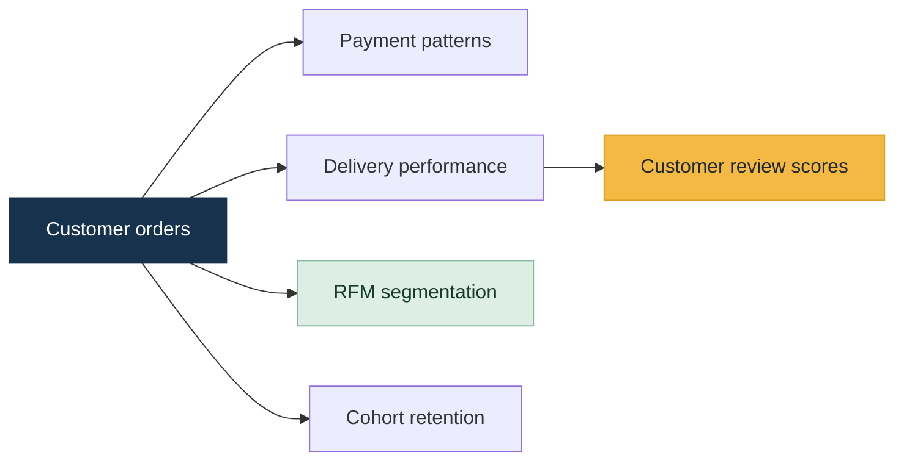

<div align="center">

# 🇧🇷 Brazilian E-Commerce Data Analysis

### Understanding customer behaviour, delivery performance, retention, and reviews with data

[](https://www.python.org/)
[](https://jupyter.org/)
[](https://pandas.pydata.org/)
[](#-project-at-a-glance)

*A data analysis project using the Olist Brazilian E-Commerce dataset.*

</div>

---

## 🔎 Project at a glance

This project explores how customers shop, how orders are paid for and delivered, how customer groups behave over time, and how delivery experiences relate to review scores. The analysis is documented in the Jupyter notebook, with a supporting report available in the `Report/` folder.

| Focus area | What the analysis explores |
|---|---|
| 🛍️ Customer behaviour | Order frequency and repeat purchasing |
| 💳 Payments and sales | Payment methods and monthly payment-value patterns |
| 🧺 Product categories | Categories with the highest recorded payment values |
| 🎯 Customer segmentation | Recency, Frequency and Monetary (RFM) customer groups |
| 🚚 Delivery performance | Delivery gaps and late-delivery patterns across states |
| 🔁 Retention | Month-by-month customer cohort retention |
| ⭐ Customer experience | Review scores by delivery status |

## 📌 Executive summary

The exploratory analysis suggests that **most customers place only one order**, while **credit cards are the dominant recorded payment method**. Recorded product-category payment values are concentrated among a smaller group of categories.

The notebook's RFM segmentation classifies approximately **32.9K customers as At Risk**, **32.1K as Loyal Customers**, **15.6K as Champions**, and **15.5K as Lost/Low Value** under its scoring method and custom thresholds.

One of the clearest descriptive patterns is the difference in average review scores by delivery status:

| Delivery status | Average review score |
|:--|--:|
| ✅ On time or early | **4.20 / 5** |
| ⚠️ Late | **2.55 / 5** |



**How to interpret this:** late deliveries are associated with lower average review scores in this analysis. This is a descriptive relationship and does not prove that delivery delays alone caused lower ratings.

> **Data-quality note:** Some notebook analyses use a merged table that joins order items and payments. An order may contain multiple items or payment records, which can duplicate values or counts when aggregating `payment_value` or counting rows. Revenue totals, category totals, state-level order counts, and monetary RFM values should be recalculated at the correct level of detail before being used as business KPIs. The final months in the monthly trend also drop to zero and need investigation. The cohort-retention heatmap's colour scale should be checked because the matrix contains percentages while its colour maximum is set to `1.0`.

## 📊 Charts and visual findings

The charts are available in the notebook and supporting report. Open the notebook to inspect the full analysis and chart outputs.

| Visualisation | What it helps investigate |
|---|---|
| Customer order distribution | Whether customers tend to order once or return |
| Monthly revenue/payment value | Changes in recorded payment value over time; validate the final zero-valued months |
| Top product categories | Categories with the highest recorded payment values; verify aggregation grain |
| Orders by state | Geographic distribution of orders; use unique order IDs for reliable counts |
| Payment methods | The relative frequency of payment types |
| RFM customer tiers | The distribution of customers across behavioural segments |
| Delivery-gap distribution | How actual delivery timing differs from the estimated date |
| Late delivery by state | Geographic differences in late-delivery patterns |
| Cohort retention heatmap | How customer activity changes after the first purchase |
| Review score distribution | The distribution of customer ratings |
| Reviews by delivery status | How average ratings differ between late and on-time/early deliveries |

📘 **Start here:** [`notebook/olist-data-analysis.ipynb`](notebook/olist-data-analysis.ipynb)  
📄 **Detailed write-up:** [`Report/olist_ecommerce_analysis_report.docx`](Report/olist_ecommerce_analysis_report.docx)

## 🧰 Tools and methods

- **Python** for analysis and data processing
- **pandas / NumPy** for data manipulation
- **Matplotlib / Seaborn** for charts and visual exploration
- **Exploratory data analysis (EDA)** to inspect distributions and trends
- **RFM segmentation** to group customers by recency, frequency, and monetary value
- **Cohort retention analysis** to examine customer activity over time
- **Delivery and review analysis** to compare customer ratings across delivery outcomes

## 🗂️ Repository structure

```text
.
├── Report/
│   └── olist_ecommerce_analysis_report.docx
├── data/
│   ├── olist_customers_dataset.csv
│   ├── olist_order_items_dataset.csv
│   ├── olist_order_payments_dataset.csv
│   ├── olist_order_reviews_dataset.csv
│   ├── olist_orders_dataset.csv
│   ├── olist_products_dataset.csv
│   └── product_category_name_translation.csv
├── notebook/
│   └── olist-data-analysis.ipynb
└── README.md
```

## 🚀 Run the analysis

1. **Clone or download** this repository.
2. Make sure the seven CSV files are saved in the `data/` folder.
3. Install Python and Jupyter Notebook or JupyterLab.
4. Install the libraries imported by the notebook. Common dependencies for this analysis include:

   ```bash
   pip install pandas numpy matplotlib seaborn jupyter
   ```

5. Open `notebook/olist-data-analysis.ipynb` and run the cells in order.
6. If your local folder differs from the expected layout, update the notebook's data paths before running it.

## 🧭 Suggested next steps

- Rebuild joined tables at the appropriate grain to prevent duplicated payment values.
- Recalculate revenue and category metrics using validated order/payment relationships.
- Use unique order IDs for state-level order counts.
- Investigate the zero-valued final months in the monthly trend.
- Review cohort-retention percentage formatting and the heatmap colour scale.
- Re-run the analysis and refresh the report after validating the metrics.

## 📚 Dataset

The project uses the **Brazilian E-Commerce Public Dataset by Olist**, distributed through Kaggle. Keep the dataset files in the `data/` folder and review the dataset's original terms and attribution requirements before redistributing the data.

---

<div align="center">

**Explore the notebook · Review the findings · Validate the metrics**

<sub>Built as an exploratory data analysis project. Findings should be treated as preliminary until the aggregation and chart-validation issues noted above are addressed.</sub>

</div>
